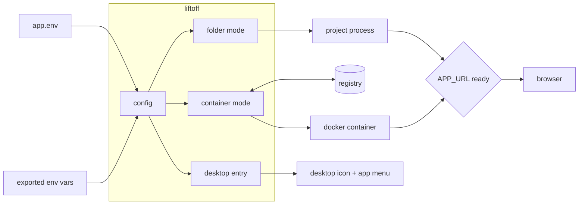
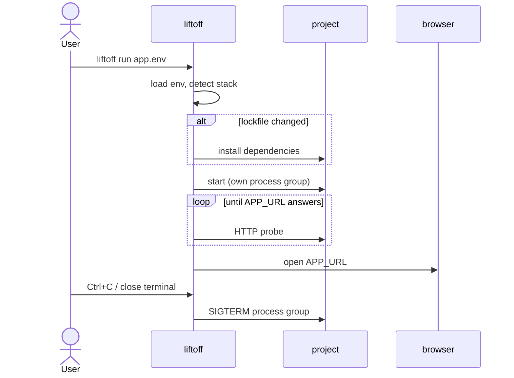

<div align="center">

# Liftoff

**Launch any app with one click: from a project folder or a container registry, configured entirely by environment variables.**


</div>

## Features

- **Two modes**: run a project from its folder, or pull and run an image from any registry
- **Stack detection**: Node (npm, pnpm, yarn, bun), Python, Maven, Gradle, Go, Rust, docker compose
- **Smart installs**: dependencies are reinstalled only when the lockfile changes or the deps folder is gone
- **Registry login**: username plus a password or token file, sent via `--password-stdin`
- **Ready-aware**: waits for `APP_URL`, opens the browser, and fails fast if the app crashes
- **Single instance**: if the app is already up, Liftoff just opens the browser
- **Clean shutdown**: Ctrl+C or closing the terminal stops the whole process tree or the container
- **Desktop launcher**: desktop icon and app-menu entry, with your picture taken from a file or a URL

## How it works



<details>
<summary>Sequence: <code>liftoff run</code> in folder mode</summary>



</details>

| Component | Role |
|---|---|
| `lib/config.sh` | Loads the env file and environment, applies defaults, validates |
| `lib/stack.sh` | Detects the install and start commands from project files |
| `lib/folder.sh` | Folder mode: deps, start, wait, stop |
| `lib/container.sh` | Container mode: login, pull, run, logs, stop |
| `lib/desktop.sh` | Writes the `.desktop` entry and stores the icon |

## Quick start

**Requires:** Linux, Bash 5, curl, plus Docker for container mode.

```bash
cp ~/Liftoff/app.env.example ~/Liftoff/apps/myapp.env    # describe your app
~/Liftoff/liftoff check   ~/Liftoff/apps/myapp.env        # verify the config
~/Liftoff/liftoff install ~/Liftoff/apps/myapp.env        # create the desktop icon
~/Liftoff/liftoff run     ~/Liftoff/apps/myapp.env        # or launch from the terminal
```

## Usage

| Command | Does |
|---|---|
| `liftoff run [app.env]` | Install deps if needed, start, wait for the URL, open the browser |
| `liftoff install app.env` | Add a desktop icon and app-menu entry |
| `liftoff uninstall app.env` | Remove both |
| `liftoff check [app.env]` | Print the resolved configuration (passwords masked) |

Exported variables override the file:

```bash
APP_URL=http://localhost:5000 liftoff run apps/myapp.env
```

## Configuration

| File | Contains | Applies |
|---|---|---|
| `apps/<app>.env` | One app's variables | On every `run`; name, icon and terminal settings on `install` |
| `app.env.example` | Every variable with its default | Reference only |
| `DOCKER_ENV_FILE` | Variables passed into the container | Container mode |

Folder mode:

```bash
APP_NAME="Notes"
APP_DIR=~/code/notes
APP_URL=http://localhost:3000
APP_ICON=~/Pictures/notes.png
APP_NODE_VERSION=20.11.0
```

Container mode:

```bash
APP_NAME="Dashboard"
DOCKER_IMAGE=ghcr.io/acme/dashboard:1.4
DOCKER_USERNAME=acme-bot
DOCKER_PASSWORD_FILE=~/.secrets/ghcr-token
DOCKER_PORTS="8080:80"
APP_URL=http://localhost:8080
APP_ICON=https://example.com/dashboard.png
```

## Project structure

```
Liftoff/
├── liftoff            # CLI entry point
├── lib/               # one module per concern (config, stack, folder, container, url, desktop)
├── apps/              # your app definitions, one .env per app
└── app.env.example    # every supported variable, documented
```

## Development

| You changed | Then |
|---|---|
| `lib/*.sh` or `liftoff` | Nothing: the next run picks it up |
| An app's `.env` (dir, URL, ports…) | Nothing: the next `run` reads it |
| `APP_NAME`, `APP_ICON`, `APP_TERMINAL` | Run `liftoff install` again |
| The project's lockfile | Nothing: the next `run` reinstalls deps |

## Troubleshooting

| Symptom | Fix |
|---|---|
| No icon on the desktop | Run `liftoff install`; then right-click the icon → **Allow Launching** |
| `stopped before … came up` | Run `APP_START_CMD` by hand inside `APP_DIR` to see the error |
| `Timed out after …s` | Check that `APP_URL` matches the app's port, or raise `APP_WAIT_TIMEOUT` |
| `Can't tell how to start …` | Set `APP_START_CMD` |
| `Node X is not installed via nvm` | `nvm install X`, or remove `APP_NODE_VERSION` |
| `Registry login failed` | Check `DOCKER_USERNAME` and the token, and that it can read packages |
# LiftOff
